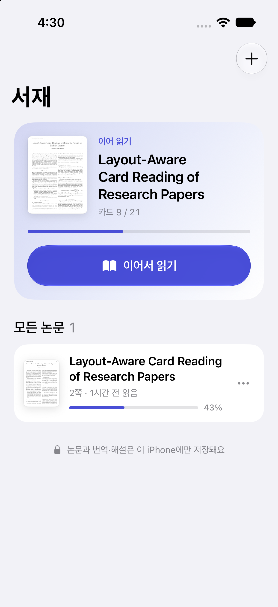
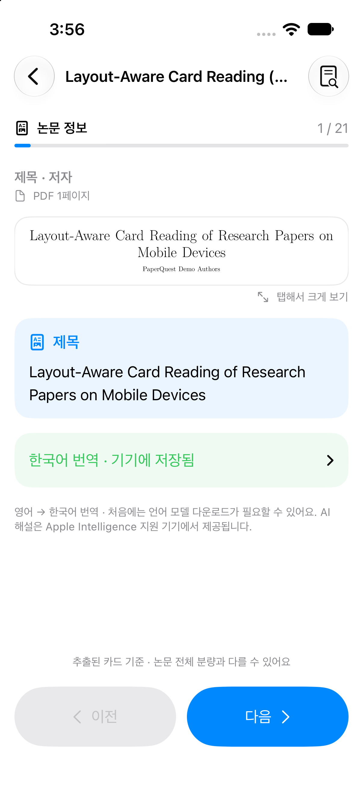
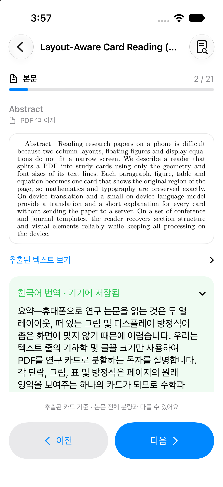
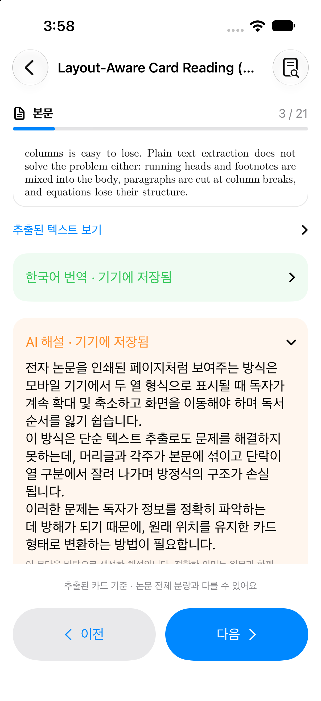
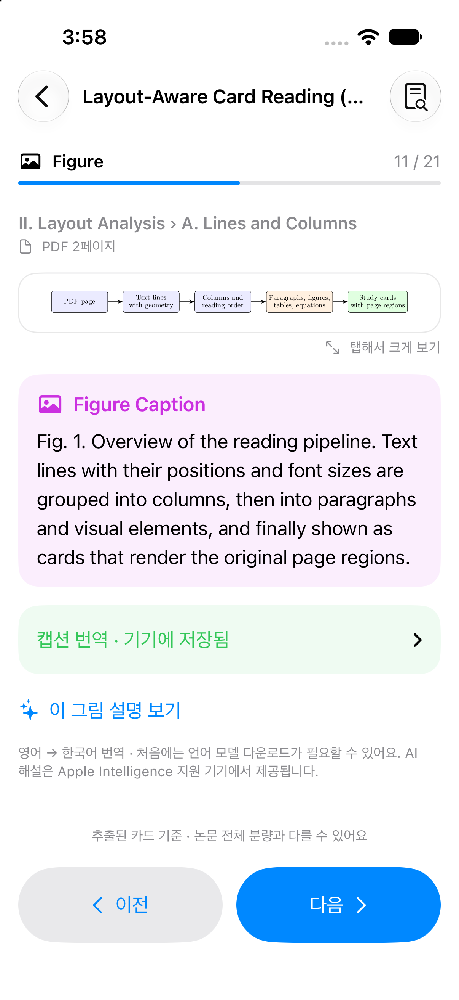
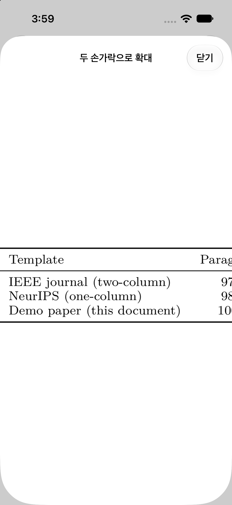
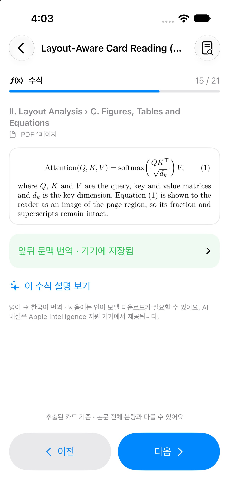
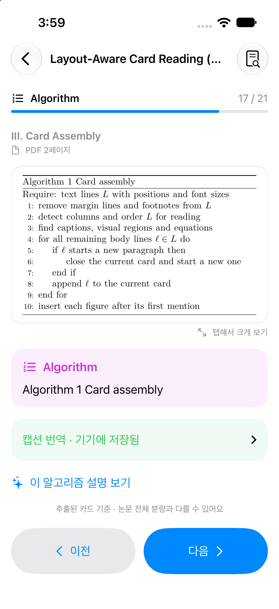
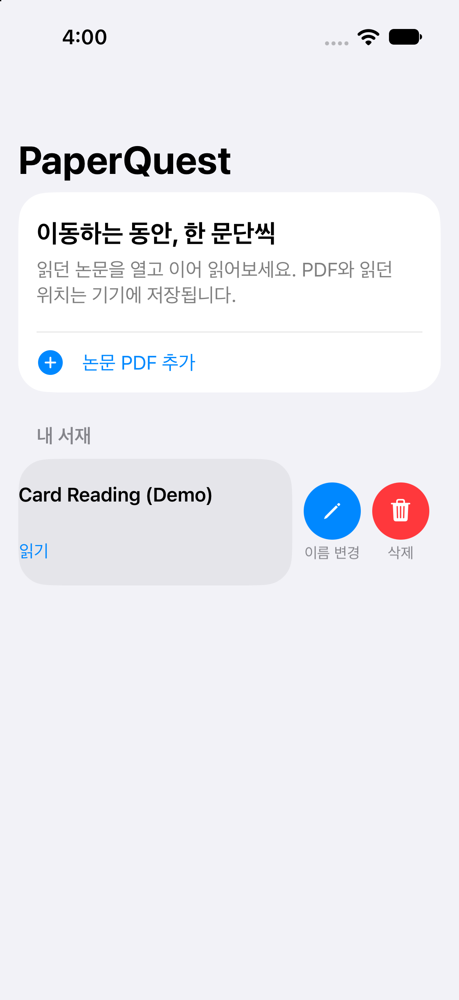

# PaperQuest

**지하철이나 버스에서도 부담 없이, 논문을 한 문단씩.**

PaperQuest는 논문 PDF를 문단·그림·표·수식 단위의 **학습 카드**로 나눠 iPhone에서 한 장씩 넘기며 읽게 해 주는 iOS 앱입니다. 각 카드에는 PDF의 해당 부분이 **원본 그대로** 보이고, 버튼 하나로 **한국어 번역**과 **AI 해설**을 볼 수 있습니다.

번역과 해설은 모두 **iPhone 안에서** 처리됩니다. 클라우드 AI나 외부 서버를 쓰지 않아서 논문이 기기 밖으로 나가지 않고, API 키나 사용료도 필요 없습니다.

> PaperQuest splits research-paper PDFs into cards (paragraphs, figures, tables, equations) that show the original page regions, with on-device translation and explanations powered by Apple's Translation and Foundation Models frameworks. No cloud services are used.

---

## 왜 만들었나

- **이동 중에 읽기 좋게**: 2단 논문을 휴대폰으로 보면 확대하고 좌우로 움직이다가 읽던 위치를 놓치기 쉽습니다. PaperQuest는 논문을 한 화면에 들어오는 카드로 나눠서, 짧은 이동 시간에도 몇 장씩 읽고 다음에 이어 읽을 수 있게 합니다.
- **기기 내장 AI를 최대한 활용**: 번역은 Apple Translation, 해설은 Apple Intelligence의 기기 내 언어 모델(Foundation Models)을 씁니다. 인터넷이 없어도(언어 모델을 받아 둔 뒤에는) 동작하고, 읽는 논문이 어디에도 전송되지 않습니다.
- **논문 모양 그대로**: 수식, 이탤릭, 그림, 표는 글자로 바꾸면 깨지기 쉽습니다. 카드에는 PDF의 해당 영역을 잘라 그대로 보여주고, 추출한 글자는 번역·해설에만 씁니다.

---

## 스크린샷

아래 화면은 저장소에 포함된 데모 논문([`docs/demo/demo-paper.pdf`](docs/demo/demo-paper.pdf))으로 찍었습니다.

| 내 서재 | 논문 정보 카드 | 본문 + 한국어 번역 |
|:---:|:---:|:---:|
|  |  |  |
| PDF를 추가하면 기기에 저장되고, 읽던 위치에서 이어 읽습니다. | 첫 카드는 제목과 저자 정보입니다. | 원문은 PDF 영역 그대로, 번역은 아래에 펼쳐 봅니다. |

| AI 해설 | 그림 카드 | 표 확대 |
|:---:|:---:|:---:|
|  |  |  |
| 기기 내 언어 모델이 문단을 쉬운 한국어로 설명합니다. | 그림은 캡션 위치를 기준으로 그 부분만 잘라 보여줍니다. | 그림·표·알고리즘은 탭하면 두 손가락으로 확대할 수 있습니다. |

| 수식 카드 | 알고리즘 카드 | 이름 변경·삭제 |
|:---:|:---:|:---:|
|  |  |  |
| 분수·첨자가 논문 그대로 보이고, 앞뒤 설명 문장도 함께 묶입니다. | 의사코드 상자도 하나의 카드가 됩니다. | 왼쪽으로 밀거나 길게 눌러 이름을 바꾸거나 삭제합니다. |

---

## 주요 기능

- **카드 단위 읽기**: 논문 정보(제목·저자) → Abstract → 본문 문단 → 그림·표·수식·알고리즘 순서로 카드를 넘깁니다. 각 카드 위에는 섹션 경로(예: `II. Layout Analysis › C. Figures, Tables and Equations`)와 PDF 페이지가 표시됩니다.
- **원본 그대로 보기**: 모든 카드는 PDF의 해당 영역을 렌더링해서 보여줍니다. "추출된 텍스트 보기"로 글자를 선택·복사할 수도 있습니다.
- **그림·표는 처음 언급된 곳에**: 그림과 표는 본문에서 "Fig. 1", "Table III"를 처음 언급한 문단 바로 다음에 나옵니다.
- **한국어 번역**: Apple Translation으로 영어→한국어 번역을 기기에서 처리합니다.
- **AI 해설**: Apple Intelligence의 기기 내 언어 모델이 섹션 제목과 앞 문단을 참고해 3문단 이내로 설명합니다. 마음에 들지 않으면 "해설 다시 만들기"로 다시 생성합니다.
- **결과 저장**: 번역과 해설은 한 번 만들면 기기에 저장되어 다시 계산하지 않습니다.
- **내 서재**: 여러 논문을 저장하고, 읽던 카드 위치를 기억합니다. 이름 변경과 삭제를 지원합니다.
- **원문 PDF 보기**: 오른쪽 위 버튼으로 현재 카드가 있는 페이지를 PDF 뷰어로 엽니다.

---

## 요구 사항

| 항목 | 조건 |
|---|---|
| Mac | Xcode 26 이상 (개발은 Xcode 27.2로 했습니다) |
| iPhone | iOS 26.5 이상 |
| AI 해설 | Apple Intelligence 지원 iPhone(iPhone 15 Pro 이상, iPhone 16·17 시리즈 등)에서 **설정 → Apple Intelligence 및 Siri**가 켜져 있어야 합니다. |
| 번역 | 처음 번역할 때 영어·한국어 언어 모델을 내려받습니다. 받은 뒤에는 인터넷 없이도 동작합니다. |
| Apple 계정 | 무료 Apple 계정이면 충분합니다. 유료 개발자 프로그램은 필요 없습니다. |

> **시뮬레이터 참고**: 번역(Translation)은 시뮬레이터에서 지원되지 않아 실제 기기에서만 동작합니다. AI 해설은 Apple Intelligence를 지원하는 Mac의 시뮬레이터에서도 동작합니다.

---

## 내 iPhone에 설치하기

### 1. 클론하고 열기

```bash
git clone https://github.com/augustinus2000/PaperQuest.git
cd PaperQuest
open PaperQuest.xcodeproj
```

### 2. 서명 설정 (필수)

번들 ID `com.junhyeok.PaperQuest`는 이미 다른 계정에서 쓰고 있으므로 **자신만의 번들 ID로 바꿔야** 설치할 수 있습니다.

1. Xcode 왼쪽 목록 맨 위의 파란 **PaperQuest** 프로젝트를 클릭합니다.
2. **TARGETS → PaperQuest → Signing & Capabilities** 탭으로 갑니다.
3. **Automatically manage signing**을 켭니다.
4. **Team**에서 본인 Apple 계정을 고릅니다. 목록이 비어 있으면 **Xcode → Settings → Apple Accounts**에서 먼저 로그인합니다.
5. **Bundle Identifier**를 `com.<내이름>.PaperQuest`처럼 바꿉니다.

### 3. iPhone 준비

1. iPhone을 케이블로 Mac에 연결하고, "이 컴퓨터를 신뢰하겠습니까?"에서 **신뢰**를 누릅니다.
2. iPhone **설정 → 개인정보 보호 및 보안 → 개발자 모드**를 켜고 재시동합니다. 메뉴가 안 보이면 다음 단계에서 Xcode가 iPhone을 한 번 인식한 뒤 다시 확인하세요.

### 4. 실행

1. Xcode 상단의 실행 대상에서 **내 iPhone**을 고르고 ▶(⌘R)를 누릅니다.
2. "신뢰할 수 없는 개발자"가 뜨면 iPhone **설정 → 일반 → VPN 및 기기 관리**에서 본인 Apple ID를 **신뢰**한 뒤 다시 실행합니다.
3. 빌드 중 Mac에 키체인 암호 창이 뜨면 Mac 로그인 암호를 넣고 **항상 허용**을 누릅니다.

### 무료 계정의 7일 제한

무료 계정으로 설치한 앱은 **7일 뒤 열리지 않습니다.** 그때 iPhone을 연결하고 Xcode에서 ▶를 다시 누르면 7일 연장됩니다. 저장한 논문, 읽던 위치, 번역·해설은 그대로 남습니다. 1년 동안 유지하려면 [Apple Developer Program](https://developer.apple.com/programs/)이 필요합니다.

---

## 사용법

1. **논문 PDF 추가**를 누르고 파일 앱이나 iCloud Drive에 있는 논문 PDF를 고릅니다. 처음 써 본다면 [`docs/demo/demo-paper.pdf`](docs/demo/demo-paper.pdf)를 iPhone으로 옮겨 열어 보세요.
2. 카드를 **다음 / 이전**으로 넘기며 읽습니다. 읽던 위치는 자동으로 저장됩니다.
3. **한국어 번역 보기**: 처음에는 언어 다운로드 창이 뜹니다. 다운로드하면 번역이 나오고 기기에 저장됩니다.
4. **이 문단 쉽게 설명하기**(그림·표·수식·알고리즘은 각각 "이 그림 설명 보기" 등): 10~30초 뒤 AI 해설이 나옵니다.
5. 그림·표·알고리즘·논문 정보 이미지는 **탭하면 확대**됩니다.
6. 내 서재에서 논문을 **왼쪽으로 밀거나 길게 누르면** 이름 변경과 삭제를 할 수 있습니다.

---

## 동작 원리

### 1. PDF를 카드로 나누기 (`PaperAnalyzer.swift`)

PDF에서 글자만 이어 붙이면(`PDFPage.string`) 위치와 크기 정보가 사라져서 머리글·각주가 본문에 섞이고, 2단 순서가 꼬이고, 수식이 깨집니다. PaperQuest는 대신 **PDFKit으로 줄마다 위치(좌표)와 글자 크기**를 읽어서 레이아웃을 복원합니다.

```
PDF 페이지 → 줄 + 좌표 + 글자 크기 → 단(column)·읽기 순서 → 문단·그림·표·수식 → 카드
```

1. **본문 글자 크기 추정**: 문서 전체에서 가장 많이 쓰인 글자 크기를 본문 크기로 봅니다.
2. **잡음 제거**
   - 여러 페이지의 위·아래 여백에 반복되는 줄은 머리글·바닥글로 보고 지웁니다.
   - 세로로 긴 줄(arXiv 스탬프)도 지웁니다.
   - 본문보다 작은 글자(각주, 저작권 안내)는 버립니다. 단, 초록과 크기가 같으면 남깁니다(IEEE는 초록이 본문보다 작습니다).
3. **단 감지와 읽기 순서**: 대부분의 본문 줄이 페이지 가운데 앞에서 끝나거나 뒤에서 시작하면 2단으로 봅니다. 그다음 "전체 폭 요소 → 왼쪽 단 → 오른쪽 단" 순서로 줄을 정렬합니다.
4. **그림·표·알고리즘**
   - `Fig. 1.`, `TABLE I`, `Algorithm 1:` 같은 캡션을 찾습니다.
   - 그림은 캡션 **위쪽**, 표와 알고리즘은 캡션 **아래쪽**을 가장 가까운 본문 줄까지 영역으로 잡습니다.
   - 본문 줄인지는 "소문자 단어가 절반 이상인 문장형 줄"인지로 판단해서, 숫자로 된 표 행과 구분합니다.
5. **수식**
   - 단 오른쪽 끝의 번호 `(1)`과 가운데 정렬된 수식 줄로 찾습니다.
   - 위아래 이웃 줄 쪽으로 영역을 넓혀서 Σ나 분수 같은 큰 기호가 잘리지 않게 합니다.
   - 수식 앞의 짧은 도입문("…is written as")과 뒤의 설명("where …")은 수식 카드에 함께 묶습니다.
6. **문단과 섹션**
   - 들여쓰기나 넓은 줄 간격에서 새 문단을 시작합니다.
   - 단이나 페이지가 바뀌어도 다음 줄이 들여쓰기가 아니면 같은 문단으로 이어 붙입니다.
   - `I. INTRODUCTION`, `3.1 …`, `A. …` 같은 번호와 짧은 폭으로 섹션 제목을 인식합니다. 너무 긴 문단은 문장 끝에서 나눕니다.
7. **카드 조립**
   - 1페이지에서 가장 큰 글자(제목)부터 마지막 저자 줄까지를 "논문 정보" 카드로 만듭니다.
   - 그림·표는 처음 언급된 문단 바로 뒤에 넣습니다.
   - References 이후 내용은 카드로 만들지 않습니다.

각 카드는 글자 대신 **PDF 영역 좌표**(`PDFRegion`)를 가지고 있습니다. 화면에 보일 때 그 영역만 렌더링하고(`PDFRegionRenderer`) 메모리 캐시에 잠시 보관하기 때문에, 페이지 전체 이미지를 들고 있지 않습니다.

### 2. 번역 (`AssistedTextBlockView.swift`)

SwiftUI의 `.translationTask`와 `TranslationSession`(Apple **Translation** 프레임워크)으로 카드 텍스트를 영어→한국어로 번역합니다. 언어 모델이 없으면 시스템이 다운로드 창을 띄웁니다. 수식 카드는 수식 자체가 아니라 앞뒤 설명 문장을 번역합니다.

### 3. AI 해설 (`ReadingAssistance.swift`)

Apple **Foundation Models**의 `SystemLanguageModel`(Apple Intelligence의 기기 내 모델)과 `LanguageModelSession`을 씁니다.

- **입력**: 카드 텍스트와 함께 섹션 제목, 앞 문단(그림·표는 그것을 언급한 문단)을 "배경"으로 넘깁니다.
- **지시**: "한국어 문장으로 쓰고, 전문 용어는 처음 나올 때 괄호에 영어를 함께(예: 슬라이딩 윈도우(sliding window))" 같은 규칙을 지시문에 넣습니다.
- **용어 힌트**: `benign → 정상`처럼 자주 틀리는 용어는 원문에 그 단어가 있을 때만 힌트로 넣습니다.
- **한국어 확인**: 답변의 한글 비율이 낮으면 한국어로 다시 써 달라고 한 번 더 요청합니다.
- **카드 종류별 지시**: 그림·표는 캡션만 보고 설명하도록, 수식은 기호의 의미를 설명하도록 지시를 다르게 합니다.

### 4. 저장

모든 데이터는 앱의 `Application Support/PaperLibrary/` 폴더에만 저장됩니다.

| 파일 | 내용 |
|---|---|
| `library.json` | 논문 목록, 이름, 읽던 카드 위치, 완료 여부 |
| `<논문 ID>.pdf` | 추가한 논문 PDF 사본 |
| `<논문 ID>.assistance/<해시>.json` | 카드별 번역·해설. 파일 이름은 카드 내용과 페이지로 만든 SHA-256 해시입니다. |

PDF 분석은 무거우므로 메인 스레드가 아닌 백그라운드(`@concurrent`)에서 실행합니다. 분석 방식이 바뀌어 카드 구성이 달라지면 `analysisVersion`을 올려서, 예전 위치 대신 첫 카드부터 다시 읽게 합니다.

---

## 프로젝트 구조

| 파일 | 역할 |
|---|---|
| `PaperQuestApp.swift` | 앱 진입점 |
| `ContentView.swift` | 내 서재 화면: PDF 추가, 목록, 이름 변경·삭제, 논문 열기 |
| `PaperLibrary.swift` | 논문 저장·불러오기, 읽던 위치, 백그라운드 분석 호출 |
| `PDFImportService.swift` | PDF 열기와 텍스트 유무 확인 |
| `PaperAnalyzer.swift` | 레이아웃 분석과 카드 생성 (위 "동작 원리" 1번) |
| `PaperModels.swift` | 카드 모델: 논문 정보, 본문, 그림, 표, 수식, `PDFRegion` |
| `PaperStudyView.swift` | 카드 넘기기 화면, 진행률, 완료 처리 |
| `SharedViews.swift` | 카드 화면들, PDF 영역 렌더링·확대 보기 |
| `AssistedTextBlockView.swift` | 번역·AI 해설 패널 (`ReadingAssistancePanel`) |
| `ReadingAssistance.swift` | 번역·해설 저장, 기기 내 언어 모델 호출과 지시문 |
| `OriginalPDFView.swift` | 원문 PDF 뷰어 |
| `CompletionView.swift` | 마지막 카드 완료 화면 |
| `docs/demo/` | 데모 논문 원본(`demo-paper.tex`)과 PDF |
| `docs/images/` | README 스크린샷 |

---

## 한계

- **텍스트가 있는 PDF만**: 스캔 이미지로 된 PDF는 글자를 읽을 수 없어 지원하지 않습니다.
- **양식**: 레이아웃 규칙은 IEEE 2단 논문과 NeurIPS 같은 1단 논문을 기준으로 맞췄습니다. 특이한 양식에서는 문단이나 그림 영역이 어긋날 수 있습니다.
- **번역 속 수식**: 번역·해설은 PDF에서 추출한 글자를 쓰므로, 문장 안의 수식은 번역문에서 깨져 보일 수 있습니다. 원문은 이미지라 정확히 보입니다.
- **해설 품질**: 기기 내 모델은 작아서 원문에 없는 해석을 덧붙이거나 용어를 틀릴 때가 있습니다. 해설은 원문과 함께 확인해 주세요.
- **부록**: References 뒤의 부록은 카드로 만들지 않습니다.

---

## 데모 논문 다시 만들기

`docs/demo/demo-paper.pdf`는 이 프로젝트를 위해 직접 쓴 짧은 IEEE 양식 논문입니다(내용 재사용 자유). LaTeX 원본을 고쳐서 다시 만들려면:

```bash
brew install tectonic
cd docs/demo
tectonic demo-paper.tex
```

---

## 라이선스

[MIT License](LICENSE) © 2026 Junhyeok Im (augustinus2000)

PaperQuest의 아이디어와 코드는 Junhyeok Im이 만들었습니다. MIT 라이선스에 따라 누구나 자유롭게 사용·수정·배포할 수 있으며, 그때 위 저작권 표시와 라이선스 문구를 함께 포함해야 합니다.
